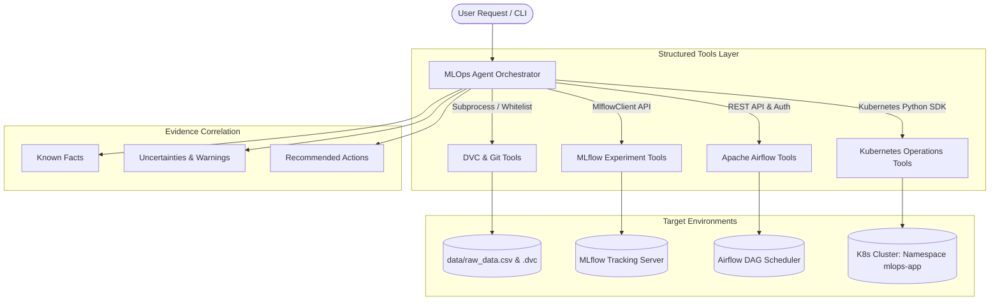

# MLOps AI Agent System Architecture & Technical Report

## 1. System Overview
The MLOps AI Agent provides a single conversational interface to coordinate complex machine-learning operations across four foundational technologies:
1. **DVC (Data Version Control)**: Manages dataset versioning, MD5 hashes, git commit provenance, and drift detection.
2. **MLflow**: Tracks experiment runs, evaluation metrics, model parameters, tags, and registry status.
3. **Apache Airflow**: Orchestrates the multi-stage training pipeline (validation, preprocessing, training, evaluation, quality gate).
4. **Kubernetes**: Manages containerized inference deployments, health checks, service discovery, and failure diagnostics.

## 2. Tool Definitions & Security Controls
| Module | Tool Name | Scope / Method | Safety / Whitelist |
|---|---|---|---|
| **DVC** | `dvc_list_tracked_data` | File inspection | Read-only |
| **DVC** | `dvc_get_dataset_version` | Subprocess Git/DVC | Whitelisted commands only |
| **DVC** | `dvc_detect_changes` | `dvc status` | Read-only |
| **DVC** | `dvc_compare_versions` | Diff inspection | Read-only |
| **DVC** | `dvc_explain_reproduction`| Guidance generation | Safe reproducible instructions |
| **MLflow** | `mlflow_list_experiments_and_runs` | `MlflowClient` | Read-only |
| **MLflow** | `mlflow_get_run_details` | `MlflowClient` | Read-only |
| **MLflow** | `mlflow_get_best_run` | `MlflowClient` | Multi-metric candidate evaluation |
| **MLflow** | `mlflow_compare_runs` | `MlflowClient` | Side-by-side run comparison |
| **Airflow**| `airflow_list_dags` | Airflow REST API | Read-only |
| **Airflow**| `airflow_get_dag_run_status` | Airflow REST API | Read-only |
| **Airflow**| `airflow_trigger_dag` | Airflow REST API | Whitelist: `ml_training_pipeline` only |
| **Airflow**| `airflow_get_failed_tasks` | Airflow REST API | Failure diagnosis |
| **Kubernetes** | `k8s_list_pods_and_deployments` | CoreV1 / AppsV1 | Read-only |
| **Kubernetes** | `k8s_diagnose_unhealthy_pods` | CoreV1 | Probe & restart analysis |
| **Kubernetes** | `k8s_execute_cluster_action` | Mutation | **Safety Lock**: requires `confirmed=True` & `namespace=mlops-app` |

## 3. Retraining Evaluation Rule
Automatic retraining is strictly prohibited. When queried:
1. Agent queries MLflow for best recent metrics.
2. Checks DVC status for dataset modifications.
3. Inspects current Kubernetes pod readiness.
4. Checks Airflow DAG execution history.
5. If no drift or degradation exists, retraining is recommended as **unnecessary**.
